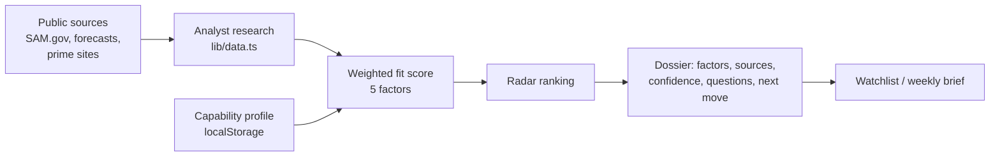

# Teaming Radar

Pursuit intelligence for small defense contractors in Huntsville, Alabama: it ranks teaming paths around Redstone Arsenal work and shows every scoring factor, source, confidence level and open question behind each ranking.

**Live:** [teaming-radar.vercel.app](https://teaming-radar.vercel.app)

## Why

Opportunity and award data for the Huntsville/Redstone ecosystem is scattered across SAM.gov, forecasts, prime contractor sites and capability statements. A SAM.gov search finds notices, but it doesn't tell a 30-person engineering firm which prime to call or what to ask. Teaming Radar turns those signals into a short dossier per pursuit, and it labels what is verified, what is an analyst hypothesis, and what is demo material.

## Features

- **Ranked radar** (`/radar`): pursuits scored 0–100 against a capability profile, with a recommendation such as "Pursue discovery" or "Validate first".
- **Explainable dossiers** (`/dossiers/[slug]`): five weighted factors (capability overlap, buyer proximity, teaming access, timing, evidence quality), each with a written reason.
- **Source states on everything**: every source carries a publisher, check date, `verified` / `analyst` / `demo` state and a confidence level.
- **Open questions and a next move**: each dossier ends with the unknowns to resolve and a concrete teaming conversation to start.
- **Capability onboarding** (`/onboarding`): profile stored only in the browser.
- **Watchlist** (`/watchlist`): browser-local, versioned `localStorage`, with an empty state.
- **Weekly brief preview** (`/brief`) and a **research queue** (`/research`) that documents the publication standard.
- **Paid brief request** (`/request`): drafts a scoped request locally, opens a pre-filled email and links to a Stripe Payment Link for the $250 founding brief.
- Security headers (CSP, frame denial, referrer and permissions policies), privacy and terms pages, robots and sitemap.

## How it works



The MVP reads typed seed data from `lib/data.ts` (five pursuits, all labeled analyst hypotheses or demo records). Profile, watchlist and request drafts live in the visitor's browser and are never sent to a server. `supabase/migrations/001_initial.sql` defines a future schema with row-level security enabled; no Supabase client is wired in yet.

## Tech stack

Next.js 16 (App Router), React 19, TypeScript, plain CSS, Node's built-in test runner. Optional Postgres schema for Supabase.

## Getting started

```bash
npm install
cp .env.example .env.local   # optional; every variable can stay empty
npm run dev                  # http://localhost:3000
```

| Variable | Purpose |
| --- | --- |
| `NEXT_PUBLIC_STRIPE_BRIEF_LINK` | Stripe Payment Link for the $250 brief. Empty shows a placeholder link. |
| `NEXT_PUBLIC_SUPABASE_URL`, `NEXT_PUBLIC_SUPABASE_ANON_KEY` | Reserved for the future Supabase persistence layer. Unused today. |

Checks:

```bash
npm test          # launch tests (offer terms, checkout, legal pages, headers)
npm run typecheck
npm run build
```

## Project structure

```
app/
  page.tsx           landing page and signal-map thesis
  radar/             ranked pursuit list
  dossiers/[slug]/   per-pursuit dossier
  onboarding/        local capability profile
  watchlist/         browser-local watchlist
  brief/             weekly decision brief preview
  research/          research queue and publication standard
  request/           paid brief request + Stripe checkout link
  privacy/, terms/   legal pages
components/          nav, pursuit card, radar visual, profile form, watch button
lib/data.ts          seed pursuits and scoring factors
lib/types.ts         Pursuit, Factor, Source types
supabase/migrations/ future schema with RLS
tests/               node:test launch checks
```

## Status

Live at [teaming-radar.vercel.app](https://teaming-radar.vercel.app) as an MVP. All shipped records are analyst hypotheses or demo data, not live opportunities. There is no authentication or database yet. Teaming Radar is independent and not affiliated with the U.S. government; it does not predict awards. Never enter CUI, export-controlled information or credentials.

Built by [Ian Royes](https://github.com/ianroyes-sys) / Royz Media Group LLC.
